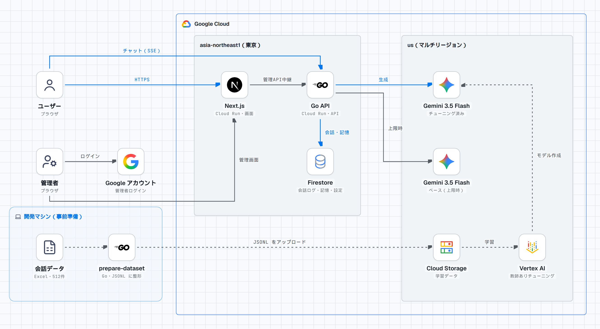

# fufuitchi-chat

**解釈不不一致チャット** — そのキャラ、そんなこと言わない。を、なくす。

プロンプトだけでは再現しきれないキャラの「らしさ」を、ファインチューニングで再現するキャラクターチャットです。
会話をまたいでユーザーのことを覚えていて、「新しい会話」を始めても前に話したことを踏まえて答えます。

キャラクターには、フリー素材キャラクター「つくよみちゃん」と、その公式の会話データセット「[つくよみちゃん会話AI育成計画](https://tyc.rei-yumesaki.net/material/kaiwa-ai/)」を使っています。

## できること

- **ファインチューニングしたモデルとの会話**: Gemini 3.5 Flash を、つくよみちゃんの会話データ（512件）で教師ありチューニングしたモデルが答えます。返事は少しずつ表示されます（ストリーミング）
- **会話をまたいだ記憶**: 同じブラウザなら、「新しい会話」を始めても、前の会話の直近10往復を覚えています
- **上限時の切り替え**: チューニング済みモデルが Google 側の利用上限に達したら、同じキャラ設定のベースモデルで代わりに答えます
- **管理画面**: Google アカウントでログインし（許可したメールアドレスだけ）、キャラ設定の編集、会話ログの閲覧・削除ができます

## 構成



| 役割 | 使っているもの |
|---|---|
| 画面 | Next.js（Cloud Run） |
| API | Go（Cloud Run）。チャットは SSE で返す |
| モデル | Vertex AI の Gemini 3.5 Flash（チューニング済み / ベース） |
| 保存先 | Firestore（会話ログ、会話をまたいだ記憶、キャラ設定、管理者のログイン） |
| 学習 | Go の整形スクリプト → Cloud Storage → Vertex AI の教師ありチューニング |

| ディレクトリ | 内容 |
|---|---|
| `frontend/` | Next.js（チャット画面、管理画面） |
| `backend/` | Go（API、会話の記憶、モデル呼び出し、データ整形スクリプト） |
| `data/characters/` | キャラシート（1ファイル1キャラの JSON） |
| `data/raw/`, `data/processed/` | 学習データ（再配布禁止のためコミットしない） |
| `scripts/` | チューニング（`tuning.sh`）とデプロイ（`deploy.sh`） |

## ファインチューニングの結果

| 項目 | 値 |
|---|---|
| ベースモデル | Gemini 3.5 Flash |
| 学習データ | 512件（train 461 / validation 51）。2往復の会話は4ターンのまま学習 |
| エポック数 | 40（Vertex AI の推奨値） |
| validation の次トークン正解率 | 56.8% → 69.3% |
| validation の loss | 3.13 → 1.32 |

同じ質問への返事の比較（ベースモデルにはキャラ設定のシステムプロンプトを渡し、チューニング済みモデルには何も渡していません）:

| 質問 | プロンプトだけ（ベース） | ファインチューニング |
|---|---|---|
| 好きな食べ物は？ | 私の好きな食べ物は「絵に描いた餅」です！ 絵から生まれた私にとって、これ以上のごちそうはありません。いつか実体を手に入れたら、人間の皆様と一緒に本物のお餅も食べてみたいです！ | 「絵に描いた餅」が好物です！ |
| 仕事がつらい | お仕事、本当にお疲れ様です……。いつも頑張っているあなたが少しでも張り詰めた心を緩められるよう、私はいつでもここで寄り添っています。どうか今夜は無理をせず、温かいお布団でゆっくりと体を休めてくださいね。 | あまりご無理はなさらないでくださいね。私はいつも、あなたの幸せを願っています。 |

プロンプトだけだと、丁寧でも長く、設定をわざわざ口に出しがちです。ファインチューニングすると、短くさらっとした、データセットのお返事に近い話し方になります。

## ローカルで動かす

```bash
cp .env.example .env          # 値を埋める（下を参照）
docker compose up --build
```

- 画面: http://localhost:3000
- 管理画面: http://localhost:3000/admin
- API: http://localhost:8080/healthz

`.env` の主な項目:

| 項目 | 内容 |
|---|---|
| `GEMINI_API_KEY` | 開発用。設定すると Gemini API（ベースモデルのみ）を使う。チューニング済みモデルを使うときは空にする |
| `GOOGLE_CLOUD_PROJECT` / `GOOGLE_CLOUD_LOCATION` | Vertex AI と Firestore を使うプロジェクト。Gemini 3 のチューニング済みモデルは `us` |
| `TUNED_MODEL_<キャラID>` | チューニング済みモデルのエンドポイント（例: `TUNED_MODEL_TSUKUYOMI`）。キャラシートの `tunedModel` より優先 |
| `STORAGE` | `memory`（再起動で消える）か `firestore` |
| `GOOGLE_CLIENT_ID` / `ADMIN_EMAILS` | 管理者の Google ログイン。クライアントIDと、許可するメールアドレス |

Vertex AI（チューニング済みモデル）や Firestore を使うときは、`gcloud auth application-default login` を済ませて、設定を重ねて起動します。

```bash
docker compose -f docker-compose.yml -f docker-compose.vertex.yml up --build
```

### 管理者ログイン（Google）

ブラウザの「Sign in with Google」が受け取った ID トークンを Go が検証し（署名・宛先・有効期限・発行元・メール確認済みか）、`ADMIN_EMAILS` に入っているアドレスだけ通します。
クライアントシークレットは使わないので、サーバーに秘密を置く必要はありません。

1. Google Cloud Console の「Google Auth Platform」で OAuth 同意画面を作る（テストモードにして、テストユーザーに自分を追加）
2. OAuth クライアントID（種類: ウェブアプリケーション）を作り、「承認済みの JavaScript 生成元」に `http://localhost` と `http://localhost:3000`（公開するならそのURLも）を追加する
3. `.env` の `GOOGLE_CLIENT_ID` と `ADMIN_EMAILS` を埋める（クライアントIDは frontend のビルド時に埋め込まれる）

### Firestore のコレクション

| コレクション | 中身 |
|---|---|
| `characters/{キャラID}` | キャラ設定。起動時に `data/characters/` から、まだないキャラだけを追加する |
| `messages/{自動ID}` | 会話の1発言（ユーザーID・セッションID付き） |
| `sessions/{セッションID}` | 会話セッションの集計（管理画面の一覧用） |
| `adminSessions/{トークンのハッシュ}` | 管理者のログインセッション（トークンそのものは保存しない） |

## 学習データとチューニング

データセットは再配布が禁止されているので、各自で[配布ページ](https://tyc.rei-yumesaki.net/material/kaiwa-ai/)から Excel をダウンロードしてください。

```bash
# 1. Excel を data/raw/kaiwa-ai.xlsx に置く
# 2. Vertex AI のチューニング用 JSONL に整形する（data/processed/train.jsonl, validation.jsonl）
docker run --rm -u "$(id -u):$(id -g)" -e HOME=/tmp -v "$PWD":/work -w /work/backend \
  golang:1.26-alpine go run ./cmd/prepare-dataset

# 3. Cloud Storage に上げて、チューニングジョブを作る（料金がかかる）
scripts/tuning.sh upload
scripts/tuning.sh create
scripts/tuning.sh status <ジョブID>   # 終わったら tunedModel.endpoint を TUNED_MODEL_<キャラID> に入れる
```

Gemini 3 のチューニングは Console からはできず、`us` / `eu` のマルチリージョンでだけ動きます。

## デプロイ（Cloud Run）

```bash
scripts/deploy.sh setup     # 初回だけ: API の有効化、イメージ置き場、サービスアカウント
scripts/deploy.sh deploy    # イメージを作って frontend と backend をデプロイ
scripts/deploy.sh teardown  # 全部消す（Firestore のデータとチューニング済みモデルは残す）
```

backend は専用のサービスアカウント（Vertex AI と Firestore だけ）で動き、インスタンスは最大2台です。学習データはイメージに入れません。
管理画面を使うなら、表示された frontend の URL を OAuth クライアントの「承認済みの JavaScript 生成元」に追加してください。

## テスト

```bash
docker run --rm -u "$(id -u):$(id -g)" -e HOME=/tmp -v "$PWD":/work -w /work/backend \
  golang:1.26-alpine go test ./...
```

## クレジット

会話AIの作成には、フリー素材キャラクター「つくよみちゃん」が無料公開している会話テキストデータセットを使用しています。

■つくよみちゃん会話AI育成計画
https://tyc.rei-yumesaki.net/material/kaiwa-ai/
© Rei Yumesaki

■つくよみちゃん公式サイト
https://tyc.rei-yumesaki.net

構成図は [stack-diagram](https://github.com/caru-ini/stack-diagram) で作成しました（アイコン: svgl / Google Cloud product icons / Lucide）。ブランドのロゴは各社の商標です。
